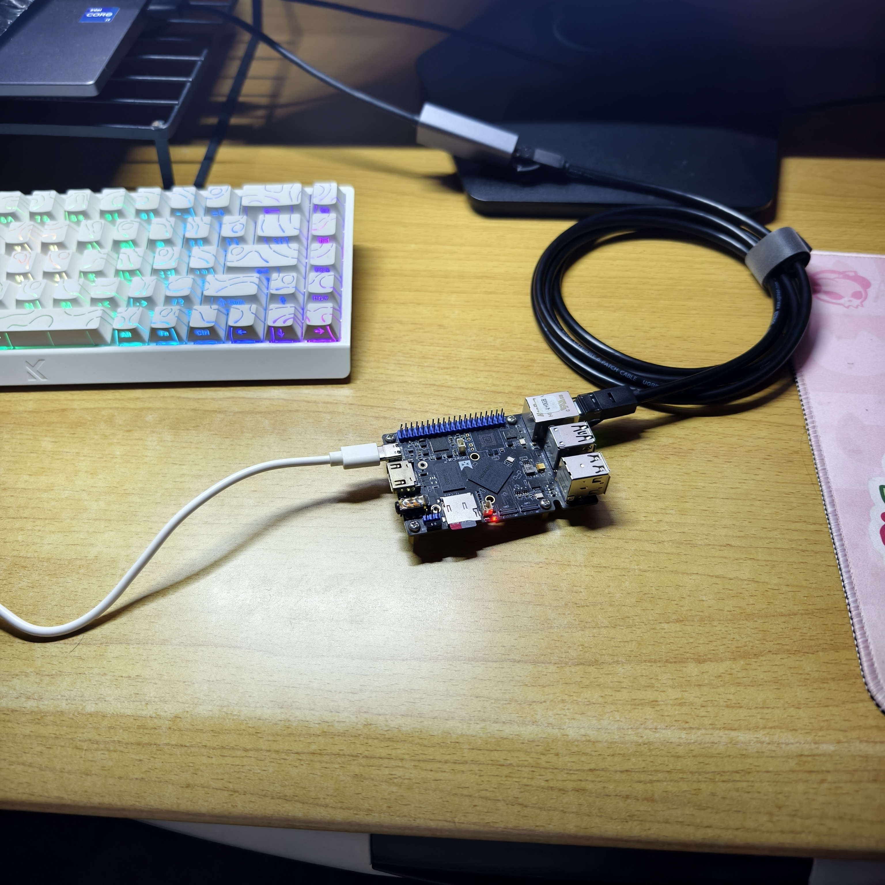
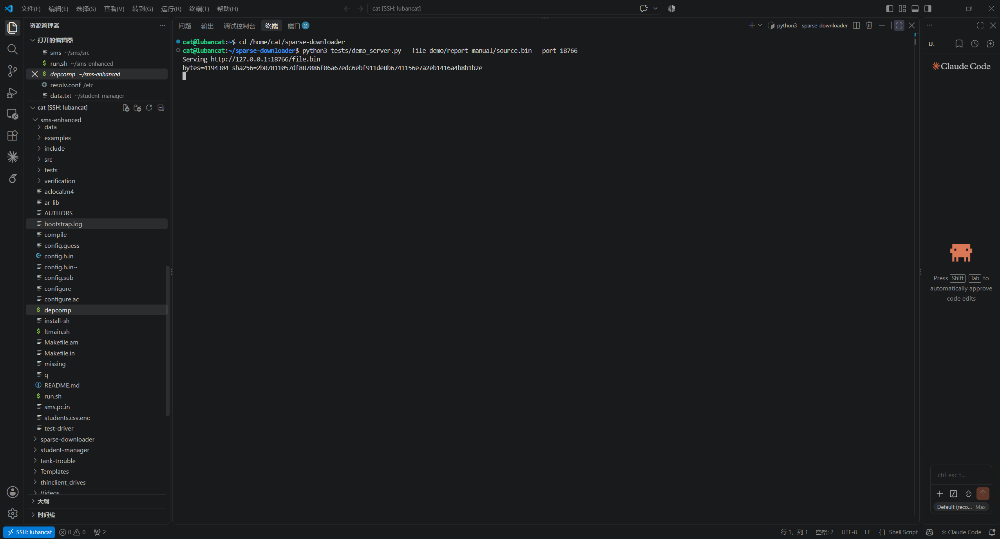
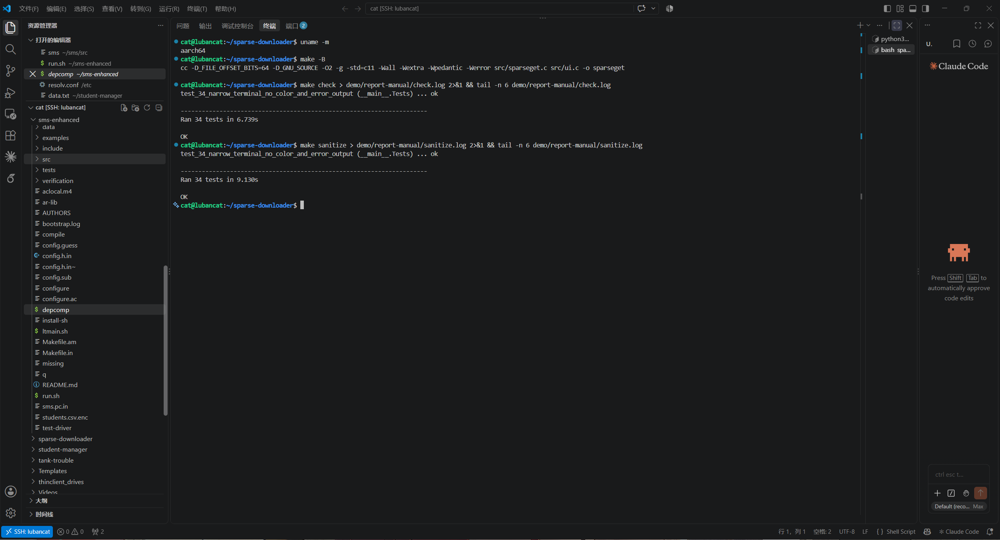
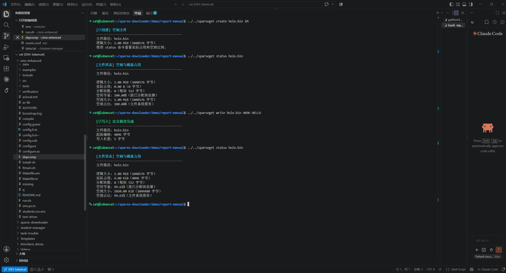
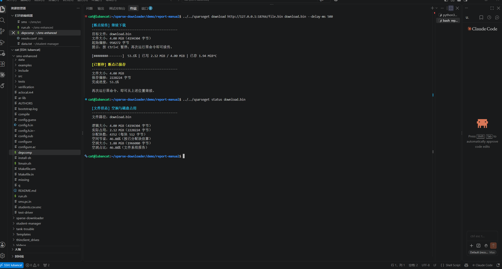
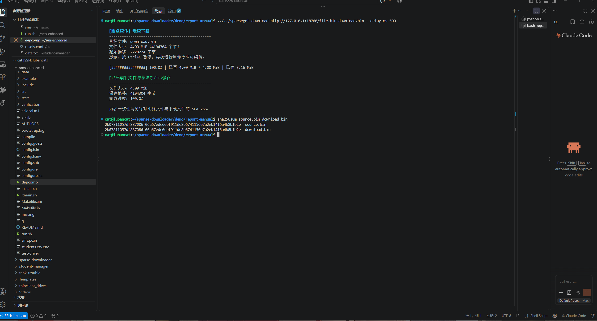

# 实验记录

实验在鲁班猫 aarch64 Linux 上运行。这里保存的是开发阶段的真实测试输出与 2026 年 10 月 13 日手动实验截图；整理仓库时没有重新进行板端运行。文件名和截图中的实验目录相互对应，复现步骤见 README。

## 测试记录

| 记录 | 含义 |
|---|---|
| [board-ui-review.txt](../validation/board-ui-review.txt) | 最终界面版本：普通版 34 项 OK（6.713 s），ASan/UBSan 版 34 项 OK（9.009 s） |
| [board-checkpoint-review.txt](../validation/board-checkpoint-review.txt) | 批量断点优化时的运行与同步调用比较 |
| [board-final-review.txt](../validation/board-final-review.txt) | 初始化恢复、构建分离及硬链接检查阶段的记录，早于最终界面版本 |
| [board-review-regressions-before.txt](../validation/board-review-regressions-before.txt) | 早期修复前 21 项中 3 项失败，作为审查对照，不代表最终版本结果 |

手动截图中的重新测试分别为 6.739 s 和 9.130 s，与日志属于不同次运行，不能混写为同一次结果。两种构建均为 34 项通过，ASan 设置 detect_leaks=0。板端时间曾存在偏差，不用其历史日志时间推定实验日期。

## 手动实验结果

- 1 MiB 空洞文件初始占用 0；4096 处写入 HELLO 后占用 4096 字节，空洞比例约 99.61%。完整内容正确性另由第 2 项回归验证。
- 4 MiB 下载手动暂停时保存偏移为 2228224；下一次从相同偏移续传，最终保存偏移 4194304。
- source.bin 与 download.bin 的 SHA-256 相同，为 `2b07811057df887086f06a67edc6ebf911de8b6741156e7a2eb1416a4b8b1b2e`。
- 进度条达到 100% 时“已存”仍可能显示上一批次值，之后的完成摘要显示最终提交结果。

## 设备与截图

以下为报告中所用的原始嵌入图片，未修改终端命令或运行数值。
### 鲁班猫设备与接线

### 4 MiB HTTP 服务器

### 编译与普通版及检测版测试

### 空洞创建与定点写入

### 手动 Ctrl+C 暂停与空间统计

### 续传完成与 SHA-256 比较

